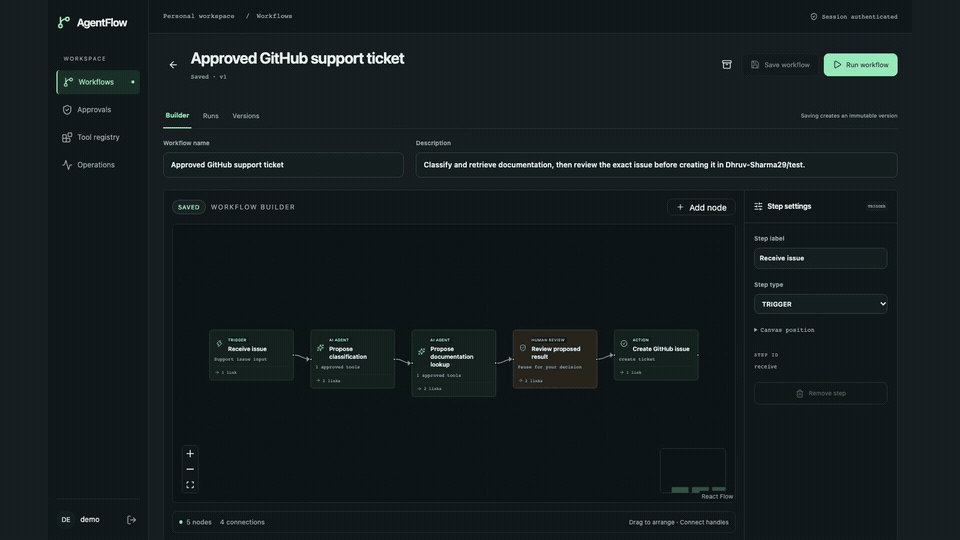
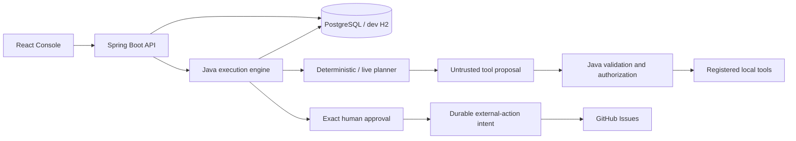

# AgentRail

### Agent workflows where the model proposes and Java decides.

> Draw a workflow in a visual editor, let a deterministic planner or an LLM propose tool calls,
> and run them on a Java engine that validates every proposal, pauses for an exact human
> approval before anything leaves the system, and records every step.

[](docs/media/agentflow-walkthrough.mp4)

**[Watch the full demo](docs/media/agentflow-walkthrough.mp4)** · 30 seconds · 1080p · silent ·
recorded under the project's former name, AgentFlow ([how it was made](docs/10-demo.md#readme-recording))

**Status: the support-intake loop runs end to end.** Workflows are drawn in a **React Flow
editor** and saved as immutable versions. The engine executes **linear workflows** with durable
checkpoints, run idempotency, cancellation and bounded retries for pure local actions. The
**deterministic planner** works offline; **Gemini** and **OpenAI** adapters are opt-in. **Human
approvals** survive a restart and bind to the exact payload. An opt-in **GitHub connector**
creates an issue only after approval, and an **Operations** page shows each owner's queues.
Branching, independent reviewers and public hosting are not built — see [Scope](#scope-v1).

**230+ automated tests, no API key or GitHub token needed.** New here?
**[Getting started](docs/01-getting-started.md)** covers both local setups; the full reading
order is in [`docs/`](docs/README.md).

With the backend and Console running ([Quickstart](#quickstart)), from the repository root:

```console
$ curl http://127.0.0.1:8080/actuator/health    # backend and database health
$ python3 scripts/smoke-test.py                 # login, save, edit conflict, history, archive
$ python3 scripts/execution-demo.py             # local actions only, no planner
$ python3 scripts/execution-demo.py --agent     # planner proposes, Java validates and executes
$ python3 scripts/approval-demo.py              # pauses until you type approve or reject
```

## Quickstart

Requires JDK 21+, Node 22.12+ (CI uses Node 24) and npm. The first start downloads dependencies.

**Terminal 1 — backend**, from the repository root:

```sh
cd backend
./mvnw spring-boot:run -Dspring-boot.run.profiles=dev
```

**Terminal 2 — Console**, from the repository root:

```sh
cd frontend
npm ci
npm run dev
```

Open [127.0.0.1:5173](http://127.0.0.1:5173) and sign in with `demo` / `demo-local-only`. Those
public credentials exist only in the local `dev` profile, which binds to loopback and stores data
in file-backed H2. No model key or GitHub token is needed.

**PostgreSQL with Docker.** With Docker running and Python 3 installed:

```sh
python3 scripts/init-local.py
docker compose up -d --build --wait --wait-timeout 180
```

Open [127.0.0.1:8090](http://127.0.0.1:8090) and sign in with the credentials generated in your
private `.env`. This is a separate database from development H2, with deterministic planning.
See [configuration](docs/05-configuration.md) and [operations](docs/07-operations.md).

## Architecture



A modular monolith keeps policy, persistence and execution in one codebase with explicit
boundaries. Network requests run outside database transactions, behind committed intents. Details
in [architecture](docs/03-architecture.md).

## What makes this different from a typical agent demo

1. **The model never executes anything.** It returns a JSON proposal; Java decides whether a
   registered handler runs.
2. **An approval binds the exact payload.** The decision carries a digest of what was reviewed,
   and every execution attempt rechecks it.
3. **Uncertainty is an outcome, not a retry.** A lost response from GitHub becomes `UNKNOWN`, with
   a read-only reconciliation path.
4. **Runs are pinned to immutable versions.** Editing or archiving a workflow cannot change a run
   that already started.
5. **Every step is on the record.** Each run keeps ordered audit events — proposals, policy
   decisions, approvals, ticket outcomes — without issue text or credentials.

## Design decisions

Four choices that shaped the rest, and what each one costs.

### 1. The model proposes; Java executes

The planner's entire output is an envelope like this:

```json
{"toolCalls":[{"tool":"classify_issue","arguments":{"subject":"Cannot log in","body":"Password reset failed"}}]}
```

Strict parsing rejects unknown fields, duplicate keys and trailing JSON. Java then checks the
whole batch — tool registration, the step's allowlist, typed arguments, the caller's current role,
and that the arguments match the original issue — before any handler runs. A denied proposal is
discarded and the step records a safe code such as `TOOL_NOT_ALLOWED` or `TOOL_CONTEXT_MISMATCH`.

**Why.** Issue text, documentation and model output are all reachable by an attacker. If the
model could dispatch tools, a prompt injection would be a permission grant. The planning request
carries no principal, credential, executor or approval handle, so the worst a manipulated model
can do is propose something Java denies.

**What it costs.** The AI surface is deliberately narrow: two read-only local tools, at most three
calls per proposal, five planner calls per run. Classification stays a keyword rule even when
Gemini selects it — the model picks *which* tool, not what it returns. These controls limit what
malicious output can do; they do not make the model immune to injection, and any new tool needs a
fresh boundary review.

### 2. An approval authorizes bytes, not intent

```json
{"decision":"APPROVE","payloadDigest":"<64 hex characters from the reviewed approval>"}
```

Java freezes the target step, operation, input, context and ticket, stores their SHA-256 digest,
and accepts a decision only if it echoes that digest. Each execution attempt rechecks the payload
and the approver's current role under the run lock.

**Why.** A reviewer who approves one issue and gets a different one has approved nothing.

**What it costs.** Any change to the inputs invalidates the approval (`APPROVAL_PAYLOAD_CHANGED`)
instead of being re-reviewed in place. Today the approver is the workflow owner, so this shows
controlled execution, not separation of duties.

### 3. A lost response is recorded as unknown, never resent

```
approve ─► commit SENDING intent ─► POST outside any transaction ─┬─► SUCCEEDED  issue #42
                                    (10 s, 64 KiB, no retries)     ├─► FAILED     safe error code
                                                                   └─► UNKNOWN    reconcile by issue number
```

**Why.** A POST can create the issue and still lose the response. Retrying would turn one
approved action into two. So the intent is committed before the request, no worker ever resends
it, and an unresolved intent expires to `TICKET_OUTCOME_UNKNOWN`.

**What it costs.** A human resolves `UNKNOWN`: check the repository, then reconcile by issue
number. Reconciliation only reads and matches the title, body and correlation marker; it never
creates a replacement. There is no exactly-once claim — only no blind duplicates.

### 4. One monolith, one database, a polling worker

**Why.** Policy, approvals and execution share transaction boundaries, so PostgreSQL row locks
serialize decisions, cancellation and worker progress without a broker. A JVM killed mid-run
resumes from its last committed checkpoint; the restart tests do exactly that against PostgreSQL.

**What it costs.** The worker is serial: a bounded provider request (up to 30 seconds) can delay
other runs, and horizontal throughput has not been measured. A broker or separate workflow engine
should follow a demonstrated need, not precede one.

## Technology

| Layer | Stack |
|---|---|
| Backend | Java 21, Spring Boot, Spring Security, Spring Data JPA, Bean Validation |
| Planning | Spring AI, deterministic adapter, optional Gemini and OpenAI adapters |
| Frontend | React, TypeScript, React Flow, Tailwind CSS, Vite |
| Data | PostgreSQL 17 and Flyway; H2 for standalone development |
| Verification | JUnit, Mockito, Testcontainers, Vitest, Playwright |
| Delivery | Docker Compose, Nginx, GitHub Actions |

Versions are pinned in [`backend/pom.xml`](backend/pom.xml),
[`frontend/package.json`](frontend/package.json) and [`docker-compose.yml`](docker-compose.yml).

## Docs

Start at [`docs/README.md`](docs/README.md) for the reading order. Highlights:

- [Product specification](docs/00-specification.md) — what is built, acceptance scenarios, non-goals
- [Getting started](docs/01-getting-started.md) — local H2 or Docker with PostgreSQL
- [Architecture](docs/03-architecture.md) — lifecycle, transactions, planner and GitHub boundaries
- [API reference](docs/04-api-reference.md) — every route, limit and error code
- [Security model](docs/06-security.md) — trust boundaries and open dependency findings
- [Contributing](CONTRIBUTING.md) — workflow, repository map, review checklist

## Scope (v1)

Linear workflows, owner approvals, local deployment. Classification and documentation search are
local tools that Gemini or OpenAI can choose to call. GitHub issue creation is opt-in, limited to
one server-configured repository, and always requires an exact approval. Branching and parallel
execution, independent reviewers, account registration and public hosting are not built — see the
[specification](docs/00-specification.md#boundaries-and-future-work) and the
[security model](docs/06-security.md#before-public-deployment). Configuration keys and package
names keep the earlier `agentflow` spelling for compatibility.
