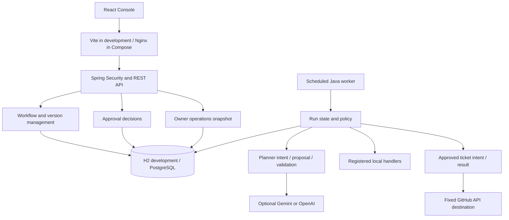
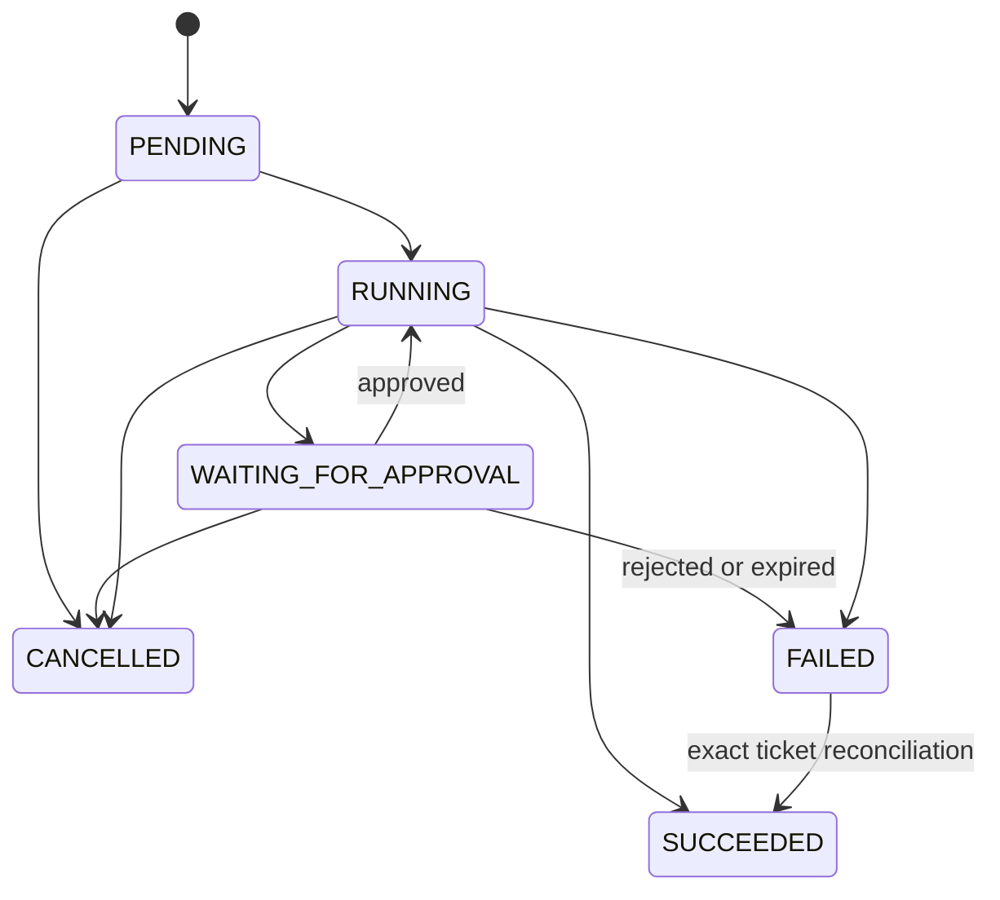

# 03 — Architecture

AgentRail is a modular monolith with a separate React build. Java owns identity, policy, execution and durable state; the planner is an untrusted proposal source. The browser presents the workflow and gathers decisions.

## Layers

```
┌────────────────────────────────────────────────────────────────────┐
│ Console   React · React Flow · Vite (dev) / Nginx (Compose)        │
├────────────────────────────────────────────────────────────────────┤
│ API       Spring Security · sessions · CSRF · owner-scoped queries │
├────────────────────────────────────────────────────────────────────┤
│ Engine    run lifecycle · checkpoints · worker · approvals         │  ← decides
├────────────────────────────────────────────────────────────────────┤
│ Planner   deterministic │ Gemini │ OpenAI                          │  ← proposes only
├────────────────────────────────────────────────────────────────────┤
│ Tools     classify · search (local) │ GitHub issue (approved)      │
├────────────────────────────────────────────────────────────────────┤
│ Storage   PostgreSQL / H2 · Flyway · audit events                  │
└────────────────────────────────────────────────────────────────────┘
```

The two rules the rest of this document follows from:

**Rule 1 — the planner proposes; it never executes.** A planner returns a JSON proposal and nothing else. Java validates the whole batch against the registry, the step's allowlist, the caller's current role and the original request before any handler runs. The planning request carries no principal, credential, executor or approval handle, so model output cannot grant itself authority.

**Rule 2 — no network call inside a database transaction.** Provider and GitHub requests are preceded by a committed intent and resolved in a separate transaction. A crash or lost response leaves a durable record of what was attempted, instead of a rolled-back transaction that hides an external effect.

## System boundary



Network dispatch occurs outside database transactions. Persisted intent/result stages handle cancellation and uncertain outcomes; only pure local handlers can use the local retry path.

## Run lifecycle



The last transition applies only to a failed run with an uncertain ticket that is subsequently confirmed through explicit reconciliation. A cancelled run remains cancelled even when a late external receipt is recorded.

## Implemented modules

| Module | Responsibility | Boundary |
| --- | --- | --- |
| auth | Persisted users, BCrypt passwords, session login, logout, CSRF | Spring Security establishes the principal; requests cannot select ownership |
| workflow | DAG validation, owner-scoped CRUD, immutable version history | Controllers pass the principal to transactional services; repositories scope object queries to owner |
| execution | Run lifecycle, local actions, durable checkpoints, cancellation, audit events | Run creation validates a saved version; the worker serializes transitions on a run row |
| agent | Deterministic and opt-in Spring AI/Gemini/OpenAI proposals, strict proposal policy | The planner receives bounded issue/context data and returns JSON; it cannot execute tools |
| tools | Code-controlled catalog, local tool policy and approved GitHub connector | AI allowlists exclude external writes; Java validates arguments, destination, roles and receipts |
| approvals | Frozen payloads, deadlines, owner inbox and decisions | Execution coordinates pause/resume under the run lock; Java rechecks the exact approved action |
| operations | Owner-scoped aggregate execution snapshot | A single SQL snapshot returns counts without input payloads or mutations |
| common | Safe controller error responses | Malformed requests are 400, missing/unowned resources 404, stale writes 409 |

Execution owns the audit records. Authentication and administrative events are not yet audited.

## Versioning and transactions

A workflow is a mutable metadata record with owner, current version, archive state, and an optimistic revision counter. Each successful create/update writes a separate version containing the complete definition and metadata snapshot. The application exposes no mutation endpoint for historical versions; version columns are marked non-updatable in JPA.

Creation writes workflow and initial version in one transaction. Update locks the owned workflow row, checks expectedVersion, validates the graph, changes metadata, and writes the next version in one transaction. The `(workflow_id, number)` database constraint prevents duplicate version numbers. Concurrent edit tests require one success and one conflict. Archive shares the same row lock and preserves versions.

Lists use bounded pagination. Details fetch only the current version, while history pages definitions oldest first. There are no lazy relationships serialized as API output and no network calls inside these transactions.

## Database and deployment

Flyway creates users, workflows, workflow_versions, workflow_runs, node_executions, approval_requests, ticket_executions, and audit_events. Hibernate validates the schema. The explicit dev profile uses file-backed H2 for standalone local work. The default profile uses PostgreSQL with required environment configuration. Local Compose binds exposed ports to loopback; Secure session cookies remain enabled in the default application configuration.

The bootstrap username is created only if absent. It is a USER account, and password changes in the environment do not reset existing credentials. Registration and credential administration require a future authenticated design.

## Deterministic execution

Run creation locks the owned workflow, resolves an explicit immutable version, validates executable semantics, and persists the run and ordered step plan in one transaction. The unique `(owner_id, workflow_id, idempotency_key)` constraint and workflow lock serialize duplicate starts. Replays also lock the run when building details. Subsequent workflow edits or archives do not alter the bound version or plan.

The scheduled worker reads at most 20 PENDING/RUNNING or expired approval IDs and calls the transactional service once per ID. Each call locks the run and advances one pure local action or a bounded local planner/tool batch. The run checkpoint, step outcome, proposal/decision, usage and audit events commit together. There is no persisted in-flight step state: a process death before commit rolls everything back; after commit the next worker skips that completed step. Concurrent workers and cancellation share the run lock. Trace reads use a repeatable-read transaction to keep run, step and event snapshots consistent.

The pure local handlers receive input, classify by local rules, search a bounded built-in catalog, and record a local result. Issue text is data; it cannot choose a URL, shell command, tool, owner, or approval. No external effects occur under database locks. Permanent handler failures terminate the run and cancel remaining steps. Explicit Java-classified pure ACTION transient failures persist bounded retry schedules under the same lock. Database transaction failures preserve the previous checkpoint for the next poll.

`audit_events` contains append-only lifecycle and step events with a unique per-run sequence. Actor ownership is available through the immutable run owner. It is not a complete security audit system yet. Submitted issue content and checkpoint snapshots are stored in run/step records and exposed only to their owner.

The process-restart script tests an abrupt Java process death against PostgreSQL and fresh-process recovery. Transaction rollback and worker races are also tested against both H2 and PostgreSQL. These guarantees apply to the current local handlers; a database transaction cannot provide exactly-once external execution.

V2/V3 preserve existing workflow and run records. V3 adds run mode/usage, optional agent settings and proposal/decision metadata. Old runs default to DETERMINISTIC with zero planner/tool usage. A database constraint requires each saved step to have exactly one of operation, agent settings or approval settings. V5 adds immutable approval requests and paused time; V6 adds persisted local retry schedules. Disable the worker to stop automatic advancement while preserving history. A rollback artifact must retain applied migration metadata; older artifacts have not been tested against the newer schema. Schema rollback requires a database backup/restore, rather than automatically discarding history.

## Planner and tool boundary

An AI_STEP freezes a goal, workflow tool allowlist and per-step tool budget in its version and execution plan. The default planner is local and deterministic. Live mode uses Spring AI 1.1.8 with automatic tool execution disabled and definition-only callbacks that cannot dispatch tools. Both return an untrusted JSON proposal, with no principal, executor, approval handle or credential in the planning request.

ProposalPolicy rejects oversized/malformed output, duplicate keys, trailing JSON and unknown fields. It validates the complete batch before any handler runs. ToolRegistry then checks registration, workflow permissions, strict typed arguments, current persisted role and server-derived issue/category context. Accepted arguments are serialized into immutable strings and revalidated before dispatch to their registered local operation. Rejected raw proposals are discarded; the trace retains a safe denial code. Code owns the two AI-proposable read-only definitions and the separate external ticket descriptor; catalog persistence and administrative registration are future work.

Runs containing agent steps have limits of five planner calls, ten tool calls, three calls per proposal (also constrained by the step budget), 16 KiB per proposal, and 120 active seconds from RUNNING (all modes), excluding approval wait time. The worker checks elapsed budget before each step. Deterministic counters, approved proposals and tool checkpoints survive process restart and roll back together on transaction abort. Live usage uses separate intent reservations and result accounting, described below.

Policy APPROVED means Java validation passed; it is not human approval. Only local read-only tools can be proposed. Only explicitly configured approval checkpoints can execute; others fail closed. Model/provider failures are tested through controlled planner faults and return PLANNER_FAILURE without internal details.

## Live request and result stages

V4 adds planning intent UUID, frozen request, planning state and deadline to the existing step, plus immutable run model identity and token accounting. Claiming an eligible agent step commits REQUESTED and one call/18,000-token reservation under the run lock. A competing worker cannot claim it again. Dispatch occurs outside transactions; the result transaction verifies the unresolved intent, cancellation, deadlines, reported usage and current owner role before applying the same Java proposal policy. The accepted result, local tool checkpoint, actual reported token usage and audit events commit atomically. Duplicate results are ignored.

The intent expires after at most 35 seconds, capped at the run's deadline. The adapter allows at most 30 seconds, uses HTTP connection/read timeouts, refuses redirects, caps input at 15,000 UTF-8 bytes, output at 1,024 completion tokens and HTTP response at 64 KiB. Each run reserves at most 90,000 tokens. The reservation is a conservative application cap, not a provider tokenizer or billing guarantee. Returned token usage is bounded by the reservation. The scheduled worker is serial, so a slow provider request can delay other runs; cancellation uses an independent HTTP transaction.

Cancellation marks an in-flight intent ABANDONED. Late results cannot authorize tools. A crash or result-transaction rollback leaves REQUESTED; a fresh worker fails it with PLANNING_OUTCOME_UNKNOWN after expiry, without reissuing a potentially billed request. Reservations are not refunded on uncertain outcomes, cancellation or provider rejection. Reported token totals include accepted result transactions; they are not a billing ledger. Provider retries and recursive tool/model loops are disabled. Bounded error parsing preserves only allowlisted failure categories; rejected body text and prompts are not logged by the OpenAI model logger.

Changing provider configuration affects new runs. Existing deterministic runs retain their mode. Pending live runs need their original provider configured; otherwise they fail with PLANNER_UNAVAILABLE before network dispatch. The run freezes its provider mode and requested model. Credentials remain process configuration, never run data. The `openai` and `gemini` profiles read the ignored repository credential file when launched from backend; default mode does not require an API key.

Sensitive effects require a durable human approval bound to the exact action payload. The GitHub connector implements the separate intent/reconciliation boundary described below; additional remote tools need equivalent treatment of uncertain outcomes.

Independent reviewer roles, branching semantics and additional external tools remain future work. Persisting AI/action node labels has no side effect. Both provider paths are tested offline with mocked HTTP responses. Gemini uses Google's fixed OpenAI-compatible endpoint through the existing Spring AI client, without enabling automatic callbacks or adding dependencies.


## Approval and local retry checkpoints

The linear plan allows an APPROVAL immediately before RECORD_RESULT or a final CREATE_TICKET action. Execution freezes the original issue, checkpoint and target operation as JSON and records its SHA-256 digest and required USER role. The owner can inspect and approve/reject through session/CSRF-protected APIs. A run row lock serializes decisions with workers and cancellation. The approval run-ID lookup uses a projection before locking to avoid caching a stale approval entity during competing decisions. No client/model can choose the payload, role or ownership.

Approval pauses and decisions commit atomically with audits. Rejected/expired requests terminate the run; cancellation closes outstanding approvals. A decision adds persisted wait milliseconds to the active deadline. Execution rechecks approved status, current persisted role and exact frozen payload/context before each action attempt. The inbox is bounded and owner-scoped; unexpired waiting runs do not occupy the worker's runnable page.

Pure Java ACTION handlers may classify a failure as transient. An explicit operation allowlist prevents newly added effecting tools from inheriting retry permission. Three attempts are permitted, with persisted 2/4-second backoff and 0–500 ms jitter. No handler runs before nextAttemptAt; success, failure and cancellation clear it. Unsuccessful attempts preserve the prior checkpoint and add safe STEP_RETRY_SCHEDULED audits. Run deadlines include delays. Agent batches, provider calls, denials and uncertain external outcomes never enter this retry path. Database commit failures roll back the attempted local work; only pure handlers may be replayed safely. The GitHub ticket connector uses the separate durable-intent path described below.


## Visual workspace

The React/TypeScript frontend is a separate Vite project. `api.ts` owns fixed same-origin API requests and in-memory CSRF state; login refreshes the token after Spring's session rotation. Cookies remain HttpOnly and are not copied to local storage. An expired current session unmounts protected views; delayed 401 responses from an older session cannot clear a newly established one.

`graph.ts` converts only the strict workflow contract to/from React Flow nodes and edges. Optional coordinates are bounded to ±10,000 and stored in version JSON; React Flow internals never enter an API definition. The editor reflects the engine's linear-chain restrictions, retains conflicted drafts and requires a saved version before starting. Java independently validates every definition and start.

`useResource.ts` scopes responses to resource identity, cancels unmounted loads and serializes polling. Workflow/version/run/approval lists use bounded pages. Execution polling stops after terminal status once any in-flight ticket intent has also settled. Owner identity is supplied only by the Java session. Each unchanged run submission retains one request key across an uncertain HTTP result; the server enforces idempotency. Mutations and approval decisions have no automatic retries.

The approval view displays the server's exact frozen payload as React text, with its digest, role and deadline. Its explicit review checkbox is bound to request ID and digest; a stale or failed decision clears it and refreshes the request. This interface never grants permission: Java verifies ownership, current roles, digest and lifecycle under its run lock.

Development Vite binds to loopback 5173 and proxies only API/health paths to loopback 8080. No CORS exception is configured. Production requires the static build and API behind the same HTTPS origin. The browser test harness starts an isolated deterministic backend and frontend, without file-backed development data or paid requests.

## Container deployment

Compose serves compiled React assets through a non-root Nginx web container, with same-origin API forwarding to Java. Only the web origin is published on loopback 8090. Java and PostgreSQL communicate on an internal data network; PostgreSQL persists data in a named volume. Healthy database/API dependencies gate startup, and the proxy resolves replacement Java containers through Docker DNS. Mutation proxy retries are disabled; request idempotency remains an application responsibility.

API/web filesystems are read-only with bounded temporary storage and memory. Docker defaults to deterministic planning, uses private generated bootstrap/database credentials, and has a distinct session cookie from development. Sessions require a new login after Java replacement; run/approval checkpoints remain durable. The acceptance harness verifies deployed browser behavior, complete stack recreation and a PostgreSQL restore into a separate database. [Operations](07-operations.md) and [security](06-security.md#known-dependency-findings) document the deployment limits and remaining dependency findings. A trusted public TLS ingress and supported-platform migration are follow-up work.


## GitHub effect boundary

The opt-in connector has a fixed `api.github.com` transport and one server-owned owner/repository allowlist. An AI step cannot select `create_ticket`. A final ticket ACTION uses `TicketPolicy` to construct the exact repository/title/body from the original issue and classification, with a node UUID marker. `ApprovalService` freezes those fields and rechecks them, the current owner role and connector configuration before execution.

`TicketExecutionService.claim` commits a unique per-run/per-node intent while holding the run row lock. `TicketCoordinator` releases all transactions before bounded HTTP, then commits the response under the run lock. Competing workers see the committed SENDING intent and never send it again. Network failures do not enter local-action retries. There is no claim of exactly-once GitHub delivery: an accepted request can lose its response. Unknown outcomes are retained and require an explicit issue-number GET reconciliation that matches the full frozen payload. Intent expiry also runs for cancelled runs, so crashes cannot leave the web view polling forever.

A cancellation after claim cannot undo an external write. The run remains cancelled, and any late result stays visible in its ticket receipt and audit. Tokens exist only in server configuration; readiness exposes no credential, and API errors contain only fixed safe codes. [GitHub action API contract](04-api-reference.md#approved-github-ticket-action).


## Operations snapshot

The read-only Operations module derives ownership from the authenticated principal and rechecks the persisted USER role. One aggregate SQL statement counts retained runs, active retry queues, waiting/overdue approvals and unresolved ticket intents. Ticket uncertainty remains visible even after cancellation. The response contains counts and a capture timestamp, not workflow payloads or credentials, and uses `Cache-Control: no-store`.

The Console polls every 15 seconds and marks retained counts stale after a failed refresh. These business counts are distinct from infrastructure health and do not establish worker liveness, provider quota or connector access.

## Data model and design tradeoffs

See the [table responsibilities](00-specification.md#identity-and-data) and [Flyway migrations](../backend/src/main/resources/db/migration/) for persisted schema. Run records bind workflow versions; node executions carry ordered checkpoints, approval requests bind exact actions, and ticket executions preserve external intent/receipt state.

The monolith keeps policy and transaction boundaries in one codebase. PostgreSQL row locks serialize competing decisions and advancement. Polling avoids a separate broker but the current serial worker can delay other runs during bounded remote calls. Immutable versions and retained traces aid inspection but require a future retention strategy at scale. Owner approval demonstrates controlled execution, not separation of duties.
